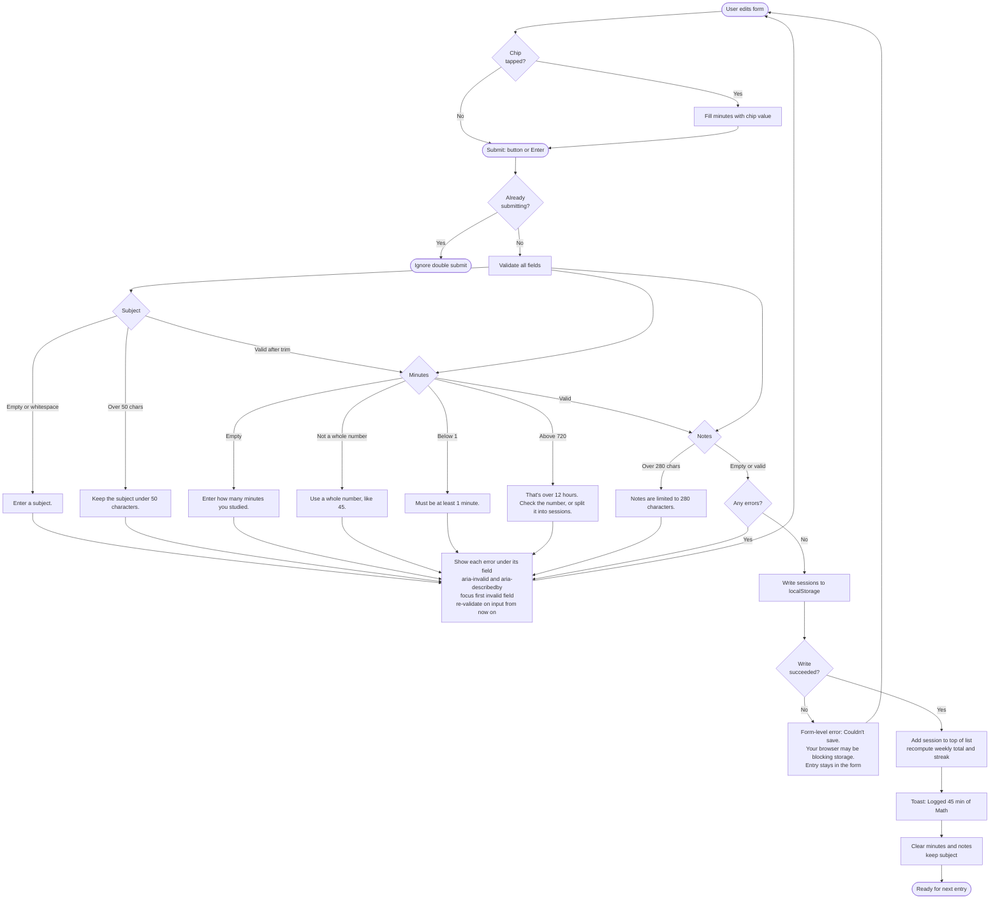

# Study Session Log

Log study sessions (subject, minutes, optional notes), see them in a list with this week's total, and come back later to find your streak and history still there. Built with Next.js (App Router) and Tailwind, deployed on Vercel. There is no sign-in, database, or API. All data lives in the browser's localStorage.

## Getting started

```bash
npm install
npm run dev
```

Open [http://localhost:3000](http://localhost:3000).

## Scope

- Week starts Monday, in the device's local time.
- Sessions are always logged for today (no date field).
- Delete only, with an inline Yes/No confirm. There is no edit.
- Quick-minute chips (15 / 25 / 45 / 60). No weekly goal.

The same diagrams are in [flows.md](flows.md).

## Flow 1: First visit


## Flow 2: Logging a session



## Flow 3: Coming back


The streak counts consecutive local calendar days with at least one session, ending today if logged, otherwise ending yesterday. It breaks only when a full day passes with no session.

## Onboarding research

How three apps welcome a new user. Public sources were thin for all three, so each entry separates what was found from what is inference. I did not run the apps myself.

### Toggl Track

- **Found:** Signup is long, with roughly 8 to 10 screens before the app: email, password, name, how you heard about it, industry, signup reason, team members, workspace setup, and billing. After signup, a modal offers exploring alone or a guided tour. The tour uses skippable, resumable tooltips for tracking time and creating projects, then offers a second tour on Reports. The Timer page is the hub.
- **Not found:** the exact first screen, the empty state, and the time to the first entry.
- **Inference:** the first timer probably happens inside the tour, about 2 minutes in.
- Sources: [Appcues GoodUX teardown](https://goodux.appcues.com/blog/toggl-onboarding-tour), [Pageflows recording](https://pageflows.com/post/desktop-web/onboarding/toggl-track/), [Toggl help center](https://support.toggl.com/en-us/article/track-end-user-guide-pcn5n4/).

### Forest

- **Found:** The first screen is an empty patch of ground, a timer, and a tree picker. The first tree takes 3 taps: choose a tree, set the time (default 25 minutes), and tap Start. A new user has no trees and a few starter species, and coins from finished sessions unlock more. Signing in syncs across devices, but no source says an account is required.
- **Not found:** official onboarding docs, permission prompts, and the empty stats screen.
- **Unverified:** a single 2019 review reported a few explainer screens and an account prompt after the first session.
- Sources: [Theory7 guide](https://www.theory7.net/support/en-us/tips-tricks/forest-app-focus-by-planting-trees), [App Store listing](https://apps.apple.com/us/app/forest-focus-for-productivity/id866450515).

### Streaks

- **Found:** The first habit is one short setup: pick a preset or write your own, choose days, choose notifications, then tap Save Task. Notifications are chosen per task, and Health access is requested only for Health-linked tasks. Sync uses iCloud, and the App Store page mentions no sign-in. It is a one-time paid app.
- **Not found:** the first screen, the empty state, and how streaks look on day one. No fallback app was used because Loop Habit Tracker's sources were just as thin.
- **Inference:** the first habit takes under a minute.
- Sources: [App Store listing](https://apps.apple.com/us/app/streaks/id963034692), [The Sweet Setup](https://thesweetsetup.com/how-to-track-your-habits-using-streaks/), [Headway review](https://makeheadway.com/blog/streaks-app-review/).

### Recommendation for the first visit

1. **Start with the action, not a questionnaire.** Forest gets a first result in about 3 taps. Toggl asks 8 to 10 screens of questions first. This app has no account, so there is nothing to ask. The form is the first screen.
2. **Use defaults and one-tap shortcuts.** Forest defaults to 25 minutes. The minute chips (15 / 25 / 45 / 60) do the same job, so a first session takes a subject, one chip tap, and Log.
3. **Skip the tour.** Toggl's tour is skippable, but a one-field form doesn't need one. The "Start today" streak and "0 min this week" stats already say what the app does.
4. **Keep setup to the fields that matter.** Streaks asks for a title, days, and reminders. This app asks for a subject and minutes, and notes are optional.
5. **Ask for nothing else.** No sign-in, no notification or other permission prompts, and no goal setup.

## First-run check

I used the live app at <https://mpcs-51238-assignment-3-green.vercel.app> as a brand-new user with the goal **"Log three study sessions this week."**

**How this was done, and its limits.** An automated agent drove Chrome (Playwright) in a fresh profile with no stored data, at a desktop size (1280×800) and a phone size (390×844), and I read screenshots at each step. "The next day" was simulated by faking the browser clock 1, 2 and 6 days ahead against the data from day one. This is not a person with fresh eyes, a real phone, or a screen reader, so treat it as a careful walkthrough, not user testing. Nothing was fixed.

### What happened

| Step | Result |
|---|---|
| First load | 200 in about 0.4 s. The banner reads "Start your streak today", the stats show 0 min and 0 days, and the Subject field is already focused. |
| Impatient first click (empty submit) | Errors appeared under both fields ("Enter a subject.", "Enter how many minutes you studied."), and focus moved to Subject. |
| Session 1 (Math, 45 min chip, on Today) | 3 actions. Banner became "1-day streak. You're done for today." This week showed 45 min and a toast confirmed it. |
| Session 2 (Reading, 25 min, with notes, on Log) | Stayed on `/log` with a toast. Minutes and notes cleared, subject kept. |
| Session 3 (Coding, 60 min chip, on Today) | This week showed 2 h 10 min. |
| History | All three sessions were listed under "Today" with the notes and a Delete button on each. |
| Next day | Banner: "Welcome back! 1-day streak. Log a session today to keep it." The streak card said "Log today to keep it". Logging again made it a 2-day streak. |
| Two days later | "Your last streak was 1 day. Start a new one today." The streak card showed 0 days. |
| Next Monday | This week reset to 0 min, as expected. |

**Verdict:** the main task works, and history and the streak survive a reload and a day change. All three sessions were logged without any real stumbling block. Every problem below is about clarity and phone layout, not correctness. I found no bugs in the streak states.

### Where I got confused

1. **Nothing counts sessions.** My goal was three sessions, but the app only shows minutes ("2 h 10 min"). I had to count rows in Recent or History to know I was done. This was the biggest mismatch with the goal.
2. **Two places to log.** Today has a form and so does Log. The only difference is a Notes field, and nothing says so. On Today there is no hint that notes exist, so a new user can't tell why the nav has both.
3. **The banner and the streak card say the same thing.** On every return visit "1-day streak" appears in the banner and again in the Streak card. "Last time: …" also repeats the top row of Recent. That is three places for one fact.
4. **"Weeks start on Monday" under the weekly total** reads as filler. It answers a question a new user hasn't asked, in the spot where a count or a hint would be more useful.
5. **Retyping the subject.** Subject is kept only if you log the same subject again. Three different subjects meant three fresh entries with no suggestions.
6. **Nothing says data stays in this browser.** A new user is never told that clearing site data, switching browsers or devices, or using a private window loses the history. This matters most for something built around a streak.

### What was slow

- **Speed is fine.** The first load took about 0.4 s, and route changes felt immediate.
- **On a phone, the first useful action is slow to reach.** The banner and two stacked full-width stat cards come before the form. At 390×844, the Subject field is at 684 px, and the **Log session button is at 920 px**, off the first screen. The banner says "Log your first session below", but "below" is off-screen. This undercuts the "useful right away" goal on first visit.
- Three sessions took about three actions each (type the subject, tap a chip, press Log). Any session on Log needs a trip through the nav and back.

### Smaller things I noticed

- **The toast covers content on a phone.** It sits at the bottom of the screen and hid the "Today" group heading and part of the first Recent row for about 4 seconds.
- **The focus box overlaps the "SUBJECT" label.** On first load the auto-focused field's outline clips the top of the label, which looks like a glitch.
- **The Log button jumps down when errors appear.** It shifts by the height of the messages, so the cursor or finger lands off it.
- **Touch targets are small.** Measured sizes: quick-minute chips 72×30 px, nav links 28 px tall, Delete 85×32 px. These meet the WCAG 2.2 minimum of 24 px but not the common 44 px guideline.
- **The 60 min chip wraps** to a second row on a phone, leaving a lone chip.
- **Today's Recent list shows only three sessions.** "All history" appears only once there are more than three.

### What was missing

- A **sessions-this-week count** (and optionally a goal like "3 of 3").
- **Subject suggestions** from recent subjects.
- A one-line note about where data is stored.
- Editing a session (out of scope on purpose; delete is the only fix for a typo).
- Any way to export or clear all data.

### Suggested priorities (not done)

1. Show a sessions-this-week count, replacing the "Weeks start on Monday" note.
2. On phones, put the quick log first or shrink the stat cards, so the form and button fit on the first screen.
3. Add the "stored in this browser" note.
4. Merge or trim the repeated streak and last-session text, and explain how Log differs from Today (or drop the second form).
5. Subject suggestions, toast position on phones, and touch target sizes.

## Deploy

Deploy on [Vercel](https://vercel.com/new). No environment variables are needed.
