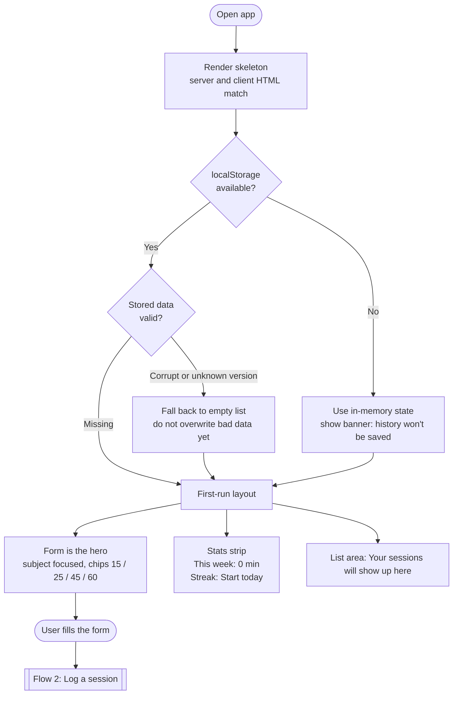
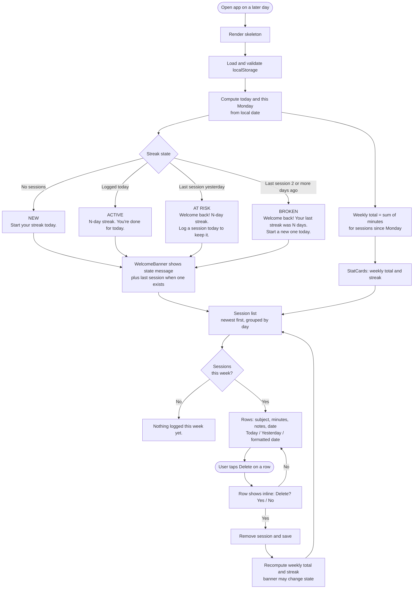

# Study Session Log

Log study sessions (subject, minutes, optional notes), see them in a list with this week's total, and come back later to find your streak and history still there. Built with Next.js (App Router) and Tailwind, deployed on Vercel. There is no sign-in, database, or API. All data lives in the browser's localStorage.

## Getting started

```bash
npm install
npm run dev
```

Open [http://localhost:3000](http://localhost:3000).

## Scope

- Week starts Monday, in the device's local time.
- Sessions are always logged for today (no date field).
- Delete only, with an inline Yes/No confirm. There is no edit.
- Quick-minute chips (15 / 25 / 45 / 60). No weekly goal.

The same diagrams are in [flows.md](flows.md).

## Flow 1: First visit



## Flow 2: Logging a session


## Flow 3: Coming back



The streak counts consecutive local calendar days with at least one session, ending today if logged, otherwise ending yesterday. It breaks only when a full day passes with no session.

## Deploy

Deploy on [Vercel](https://vercel.com/new). No environment variables are needed.
